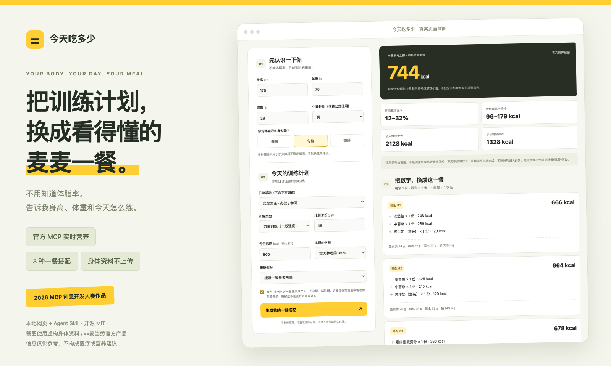

[](docs/screenshot.png)

# 今天吃多少 🍔

**今天练什么，这顿吃多少？不用知道体脂率，把训练计划变成看得懂的一餐。**

面向想了解一餐营养、又不想手算热量的成年麦当劳爱好者与日常运动人群。通过 **麦当劳官方 MCP 实时营养数据**，将身高、体重、身材描述和当天训练计划转换为透明的热量参考与餐品组合。

这是 [2026 麦当劳程序员创意开发大赛](https://github.com/M-China/mcd-developer-innovation-challenge)参赛作品，**不是麦当劳官方产品，也不是医疗、营养或运动处方**。

**[快速开始](#3-分钟运行) · [完整页面截图](docs/screenshot.png) · [Agent Skill](skills/jintianchiduoshao/SKILL.md) · [MCP 接入说明](MCP_INTEGRATION.md)**

封面为实际运行页面，使用虚构身体资料和官方营养数据。点击封面可查看完整截图；截图中的餐品数据为拍摄时结果，不代表实时价格或门店供应。

## 有什么不一样

- **不问体脂率**：先问身高、体重、身材（偏瘦 / 匀称 / 微胖），再问训练类型和分钟数。年龄、生理性别用于成人估算公式；体脂只展示粗估范围。
- **训练变成一餐参考**：区分日常活动与额外训练，用净 MET 估计消耗，不重复计算静息热量，也不把整天热量都换成一顿。
- **真实数据、真实边界**：调用 `list-nutrition-foods`，展示每份热量、蛋白质、脂肪、碳水和钠；没有官方数据就报错，不伪造热量。
- **3 种可解释搭配**：一份主食，最多一份配餐和一份饮品；支持蛋白质优先、钠更少和排除不想吃的餐品。
- **隐私优先**：网页身体资料仅在浏览器内存中计算，不上传、不持久存储。Token 仅在本机服务端环境中读取；无订单、地址、手机号或付款操作。
- **双入口**：本地网页 + 可安装的 [Agent Skill](skills/jintianchiduoshao/SKILL.md)，共享同一计算模块。

## 3 分钟运行

需要 **Node.js 22+** 和 npm。

```bash
git clone https://github.com/zongyangbigpolo/jintianchiduoshao.git
cd jintianchiduoshao
npm ci
npm run demo
```

打开 **http://127.0.0.1:3000**。演示模式无需 Token，**只含明确标记的虚构餐品和数值，不是麦当劳菜单**。

### 使用官方实时数据

在 [麦当劳 MCP 开放平台](https://open.mcd.cn/mcp)申请自己的 Token，然后：

```bash
cp .env.example .env
```

使用本机编辑器填写 `.env` 中的 `MCD_MCP_TOKEN`（只填原始 Token），再运行：

```bash
npm run check:mcp
npm start
```

`.env` 已被 Git 忽略。**不要把真实 Token 写进代码、README、Issue、截图或 MCP 配置示例。** 也不要把该本地服务直接暴露到公网。端口冲突时可在 `.env` 中调整 `PORT`；演示模式可用 `PORT=3001 npm run demo`。

实时接口错误会明确显示，**不会静默降级到演示模式**。营养数据在服务端内存缓存 5 分钟，刷新页面不一定发起新上游调用；页面展示实际获取时间。

## 使用示例

1. 填写身高 **175 cm**、体重 **70 kg**、年龄 **28**、生理性别 **男**、身材 **匀称**。
2. 日常久坐，今天计划一般强度力量训练 **45 分钟**，已吃约 **800 kcal**。
3. 选择本餐占全天 **35%**，点击“生成我的一餐搭配”。

该示例得到约 **2,128 kcal** 全天维持参考、约 **138 kcal** 净训练消耗（敏感性范围 **96–179 kcal**），本餐参考上限为 **744 kcal**。体脂显示宽范围 **12–32%**，**不是精确测量或医学判断**。实际餐品组合随官方营养数据变化。

```text
身高 + 体重 + 年龄 + 生理性别 + 身材描述
                ↓
体脂粗估范围（仅展示不确定性）
                +
日常活动 + 今天训练类型 / 时长 + 已摄入估算
                ↓
全天维持参考 → 本餐份额
                +
官方 MCP 实时餐品营养
                ↓
最多 3 种主食不同的组合 + 营养总量 + 计算依据
```

休息日不加训练消耗。训练计划不是已完成记录，请按实际情况更新。**运动不是吃饭的资格，超出参考值不意味着应跳餐、节食或额外运动。**

## 作为 Skill 使用

将 `skills/jintianchiduoshao` 目录复制到支持 `SKILL.md` 的客户端的技能目录（例如项目级 `.agents/skills/`），并在客户端配置本项目绝对路径及本机环境变量。不同客户端安装位置可能不同，请以客户端文档为准。

对话示例：

> 今天想吃麦当劳，不知道体脂率。身高 175，体重 70，身材匀称，今天练力量 45 分钟，帮我搭一餐。

Skill 会补问年龄、生理性别、日常活动、已摄入量与适用条件，然后通过本项目 CLI 运行共享算法。**不要在聊天中粘贴 Token**。网页输入不上传；使用聊天客户端时，身体信息可能由该客户端的模型服务处理，请按其隐私政策决定是否提供。

CLI 也可独立使用（下列均为虚构示例资料）：

```bash
echo '{"profile":{"height":175,"weight":70,"age":28,"sex":"male","shape":"balanced","activity":"sedentary","training":"strength","minutes":45,"eaten":800,"share":0.35,"adultGeneralHealth":true},"preference":"balanced"}' | npm run plan -- --demo
```

去掉 `--demo` 即读取本机 Token，调用官方 MCP。不得将聊天内容直接拼接成 shell 命令；应由客户端通过标准输入安全传入 JSON。

## 计算依据与局限

| 项目 | 算法 / 边界 |
|---|---|
| BMI | kg ÷ m²；个性化估算限制在 18.5 ≤ BMI < 30，范围外仍可查营养表 |
| 基础体脂估计 | Deurenberg 成人公式：`1.2 × BMI + 0.23 × 年龄 − 10.8 × 性别系数 − 5.4`，男=1，女=0 |
| 身材描述 | 只扩大不确定性：取公式 ±5 个百分点与描述宽范围的并集，显示在 5–55% 内；偏瘦 8–23%、匀称 15–32%、微胖 23–40% 为**产品假设，不是医学标准或经验证的分类器** |
| 基础代谢 | Mifflin–St Jeor：`10 × kg + 6.25 × cm − 5 × 年龄 + 常数`，男 +5、女 −161 |
| 日常消耗 | 基础代谢 × 1.2 / 1.375 / 1.55；日常活动不包含另填的训练 |
| 训练净消耗 | `(MET − 1) × 3.5 × kg ÷ 200 × 分钟`；快走 4.3、一般力量 3.5、中等骑行 6.8、约 8 km/h 慢跑 8.3 MET |
| 训练不确定性 | 展示计算值 ±30% 作为敏感性范围，不是测量或统计置信区间；实际速度、休息、技术等都会改变消耗 |
| 本餐参考 | `floor(min(全天 × 本餐比例, max(0, 全天 − 已摄入)))`，默认比例 35%；无自动减脂缺口 |
| 组合搜索 | 一份主食 + 可选配餐 + 可选饮品，热量在参考上限 65–100% 内；按偏好排序，去重主食 |

**为什么不直接用推断体脂计算热量？** 身高、体重与身材描述不能可靠测得体脂，特别是运动人群。为了避免把不确定值传递成精确饮食指令，体脂单独显示，而热量使用身高、体重、年龄等直接输入估算。不能把体脂范围解读为需要减脂。

公式参考：[Deurenberg et al., 1991](https://doi.org/10.1079/BJN19910073)、[Mifflin et al., 1990](https://doi.org/10.1093/ajcn/51.2.241)、[Compendium of Physical Activities](https://pacompendium.com/)。MET 是代表性活动值，不是每个人实测强度。

仅面向 18–65 岁一般健康成年人。未成年人、孕哺期、进食障碍、特殊疾病或需医嘱管理营养者不应使用个性化模型。肌肉量较高、特殊身体状况及性别相关治疗等情况下公式可能不适用，请选择专业建议或只查营养表。不提供过敏原保证、库存、价格或付款功能。

## 开发与验证

```bash
npm test           # 纯离线算法、解析、HTTP 边界回归
npm run check:mcp  # 使用本机 Token，只读调用官方营养工具
```

原生 JavaScript + Node HTTP 服务，无前端构建步骤；使用官方 MCP TypeScript SDK 的 Streamable HTTP 客户端和 TOON 解码器。GitHub Actions 只运行离线测试，**不需要任何账号凭证**。

```text
public/        本地网页、共享估算与搭配算法
lib/           MCP 连接、严格营养解析、显式演示数据
scripts/       实时连接检查、Skill/CLI 入口
skills/        可安装的 SKILL.md
test/          算法、数据解析和 HTTP 回归测试
```

## 参赛材料

- [CONTEST_DECLARATION.md](CONTEST_DECLARATION.md)：官方参赛声明，原文保留。
- [MCP_INTEGRATION.md](MCP_INTEGRATION.md)：实际调用、数据流及业务价值。
- [mcp-config.example.json](mcp-config.example.json)：仅环境变量占位符。客户端需支持环境变量插值，不能将字面量占位符发送给接口。
- 本项目由 GitHub Copilot 辅助开发，**未使用 WorkBuddy，不伪造 `workbuddy.md`，不申领需该文件的专项奖励**。

原创代码采用 [MIT License](LICENSE)；麦当劳名称及官方服务属于其权利人，本仓库不包含官方品牌图片或标志。
